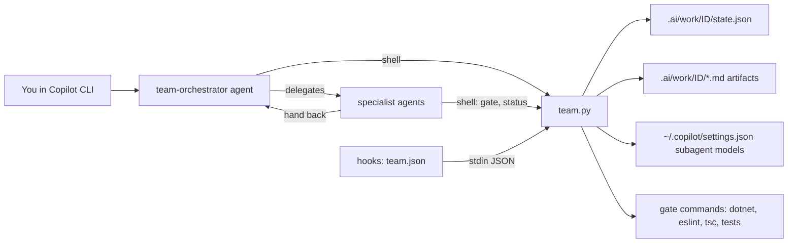
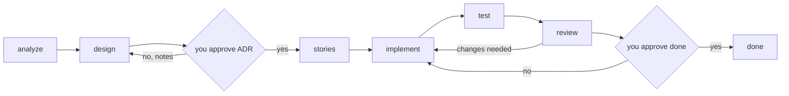
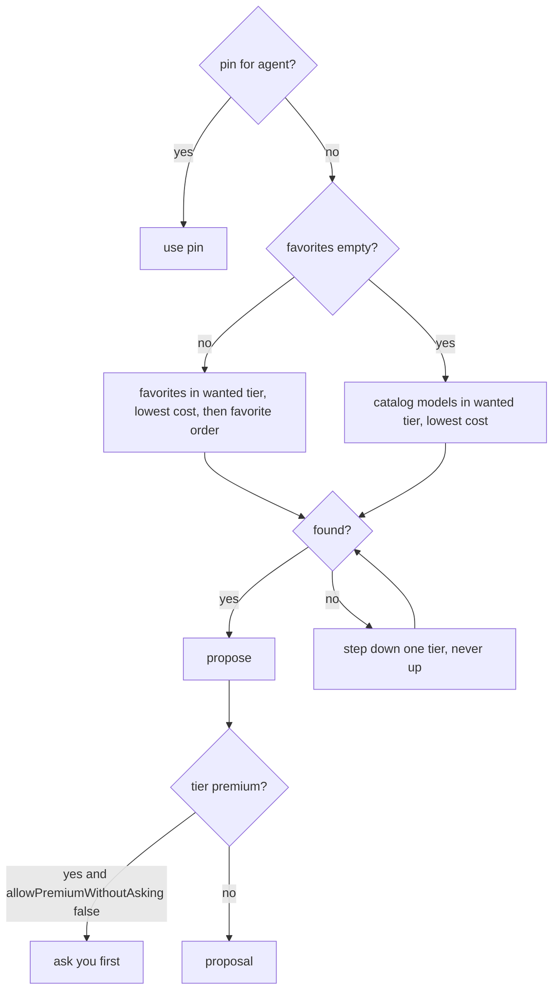

# Copilot CLI agent team: design

Status: draft, 2026-11-25. Input: [requirements.md](requirements.md). Next step: approve, then `/sc:implement`.

Name of the system in this doc: **team**. Python entry point: `team.py`.

## 0. Defaults chosen for the open questions

| question | default | why |
| --- | --- | --- |
| artifact folder | `.ai/` in the target repo, **committed** | brief, ADR and review get reviewed in the PR next to the code |
| git | script **suggests** a branch name `ai/<id>-<slug>`; no automatic commits | fewer surprises; you stay in charge of history |
| code-style install | `team.py install` calls `~/dev/code-style/install.sh user copilot` | one source of rules, no duplicate generator |

## 1. Overview



Three parts, each replaceable on its own:

1. **Prompts**: agents and skills. Markdown files that Copilot CLI loads.
2. **team.py**: Python 3.11+ stdlib. It owns state, artifacts, gates, model choice and hook logic. No LLM inside.
3. **Hooks**: one JSON file that routes Copilot CLI events to `team.py hook <event>`.

Rule of thumb: prompts **decide**, the script **records and checks**, hooks **enforce**.

## 2. Repo layout (`~/dev/agent-crew`)

```text
ai/
  README.md                     how to use it by hand and with Copilot (R9.7)
  docs/requirements.md
  docs/design.md
  agents/                       14 files, team-<role>.agent.md
  skills/
    team-workflow/SKILL.md      phases, commands, handoff contract (all agents)
    code-style/SKILL.md         checklist + link to CODE_STYLE.md (symlink)
    simplicity-check/SKILL.md   the "do we really need this?" checklist (R9)
    pipeline-idempotency/SKILL.md
    pattern-migration/SKILL.md
    dotnet/SKILL.md
    typescript/SKILL.md
  hooks/team.json               the 6 hooks from R10
  templates/                    brief.md adr.md story.md review.md (original text, R8)
  config/
    models.json                 favorites, tiers, role defaults (section 7)
    gates.json                  stack detection + commands (section 8)
    tracks.json                 phases per track (section 5)
  team.py                       entry point: `python3 team.py <command>`
  team/                         package, one module per job
    cli.py  state.py  workflow.py  artifacts.py  gates.py
    models.py  settings.py  hooks.py  install.py
  tests/                        unittest, stdlib only
```

Each module has one job and stays small (R9.7). No plugin system and no class hierarchy: plain functions,
`dataclass` for records, `json` for storage.

## 3. Agents

### 3.1 File format

```markdown
---
name: team-reviewer
description: Final quality gate. Checks CODE_STYLE, runs gates, runs the over-engineering check, writes the review report.
tools: ["read", "search", "execute"]
include-custom-instructions: true
---

Job: ... (one paragraph)
Read first: `python3 ~/dev/agent-crew/team.py context` output.
Load skills: team-workflow, code-style, simplicity-check.
Output: .ai/work/<id>/review.md from the template.
Exit checklist: ...
Hand back: say "HANDOFF team-orchestrator" plus a 3-line summary.
```

- `model` is **not** set in agent files (R6.1). Models come from `subagents.agents.<id>` (section 7).
- IDs use a `team-` prefix to avoid clashing with the built-in agents (`code-review`, `security-review`, ...).
- Body ≤ 60 lines. Know-how goes into skills (R2.3).

### 3.2 Roster

| id | job | tools | writes | direct peer (R7.2) |
| --- | --- | --- | --- | --- |
| team-orchestrator | classify, choose track, propose models, delegate, ask approvals | read, search, execute, agent | state via `team.py` only | all (hub) |
| team-analyst | read existing code, write brief | read, search, edit* | brief.md | – |
| team-system-architect | boundaries, data flow, scaling, ADR | read, search, edit* | adr.md | – |
| team-code-architect | modules, patterns, migration path | read, search, edit* | adr.md (design section), stories | – |
| team-backend | APIs, idempotency, transactions, retries | read, search, edit, execute | code | – |
| team-data | schema, migrations, checkpoint storage | read, search, edit, execute | migrations | – |
| team-frontend | UI components and state | read, search, edit, execute | code | – |
| team-implementer | general story implementation | read, search, edit, execute, agent | code | team-tester |
| team-tester | characterization tests, TDD, acceptance tests | read, search, edit, execute | tests | – |
| team-refactorer | small behavior-preserving steps | read, search, edit, execute | code | – |
| team-security | threat review, input validation, secrets | read, search, execute | findings in review.md | – |
| team-performance | measure, find bottleneck, benchmark | read, search, edit, execute | findings + benchmark | – |
| team-reviewer | CODE_STYLE + simplicity check + gates, verdict | read, search, execute, agent | review.md | team-implementer (fixes) |
| team-writer | README, docs, final ADR text | read, search, edit* | docs | – |

`edit*` = edits limited to `.ai/**` and `docs/**` by an agent-scoped `PreToolUse` hook (section 9).

Direct peers are **off by default** (`config/models.json` → `"directHandoffs": false`). They are turned on only
after the nested-subagent smoke test passes (section 12). Until then everything goes through the hub.

### 3.3 Handoff contract (all agents, in `team-workflow` skill)

1. Start: run `team.py context`. It prints the work item, the phase, the files to read and the open items.
2. Work only on your phase. Ask the simplicity question before adding anything (R9.1).
3. Write your output from the template.
4. End: `team.py handoff --from <id> --summary "<3 lines>"`, then reply `HANDOFF team-orchestrator`.

The `subagentStop` hook records the handoff even if step 4 is forgotten (R7.3).

## 4. Skills

| skill | loaded by | content |
| --- | --- | --- |
| team-workflow | all | phases, commands, handoff contract, approval rules |
| code-style | code writers, reviewer | 15-line self-check + `CODE_STYLE.md` (symlink to `~/dev/code-style`) + enforce commands |
| simplicity-check | architects, reviewer, orchestrator | the R9 questions, the red-flag list, how to write "Not doing" |
| pipeline-idempotency | architects, backend, data, tester | idempotency keys, checkpoint table, resume rules, at-least-once + dedupe, outbox, retry/backoff, poison items |
| pattern-migration | code-architect, refactorer, tester | characterization tests first, branch by abstraction, strangler, one step = one green build |
| dotnet | code writers on C# | Result<T>, ValueTask, CancellationToken, analyzers, `dotnet format` |
| typescript | code writers on TS | eslint/prettier, strict tsconfig, result unions |

Skills are short: what to do and a checklist. They are not tutorials.

## 5. Workflow

### 5.1 Tracks (`config/tracks.json`)

| track | phases | approvals |
| --- | --- | --- |
| quick | plan → implement → review → done | before done |
| full | analyze → design → stories → implement → test → review → done | after design, before done |

The orchestrator picks the track with the checklist in `team-workflow`. **Full** when any of these hold:
it changes existing behavior across more than one module, touches data/state storage or concurrency,
changes a public API, or the requirements are unclear. Otherwise **quick**. You can override it:
`team.py new --track full`.

### 5.2 Phase flow



Rules in `workflow.py`:

- `next` moves forward only when the phase output exists and is not still the empty template.
- `implement` and later phases are locked until `approvals.design` is set (full track).
- `done` needs: gates green on the current code fingerprint, review verdict `pass`, `approvals.done` set.
- `reopen <phase>` goes back and clears approvals that came after that phase.

### 5.3 Who may approve

Only you. `team.py approve` refuses to run when started from an agent tool call. Two ways it knows:
the `preToolUse` hook denies any shell tool call that contains `team.py approve`, and `approve` asks you to
type the work item id interactively (an agent's shell has no TTY).

## 6. Data in the target repo

```text
<repo>/.ai/
  current                     id of the active work item (one line)
  work/<id>/
    state.json
    brief.md  adr.md  review.md
    stories/S1.md S2.md ...
```

`<id>` = `YYYYMMDD-<slug>`, for example `20261125-state-to-pipeline`.

### 6.1 state.json

```json
{
  "id": "20261125-state-to-pipeline",
  "title": "Refactor order state machine to idempotent pipeline",
  "track": "full",
  "phase": "design",
  "difficulty": "high",
  "branch": "ai/20261125-state-to-pipeline",
  "models": {
    "team-system-architect": {"model": "claude-sonnet-5.5", "effort": "high", "reason": "concurrency + data"},
    "team-implementer": {"model": "gpt-5.5", "effort": "medium", "reason": "standard"}
  },
  "approvals": {"design": null, "done": null},
  "stories": [{"id": "S1", "title": "Characterization tests", "status": "todo"}],
  "gates": {"fingerprint": null, "results": []},
  "handoffs": [{"at": "2026-11-25T10:02:00Z", "from": "team-analyst", "summary": "..."}],
  "history": [{"at": "...", "event": "phase", "value": "design"}]
}
```

- Written only by `team.py`. Writes go through a temp file and `os.replace`, so a crash never leaves half a file.
  The `preToolUse` hook denies agent edits to `state.json`.
- `approvals.*` = `{"by": "<git user.name>", "at": "..."}` or `null`.
- `gates.fingerprint` = hash of `git ls-files -m -o --exclude-standard` contents + `HEAD`. If the code changes
  after a gate run, the result is stale.

## 7. Models: favorites, difficulty, no surprise costs

### 7.1 `config/models.json`

```json
{
  "favorites": ["claude-sonnet-5.5", "gpt-5.5", "claude-haiku-5.5"],
  "catalog": {
    "claude-haiku-5.5":  {"tier": "fast",     "cost": 1},
    "gpt-5-mini":        {"tier": "fast",     "cost": 1},
    "gpt-5.4-mini":      {"tier": "fast",     "cost": 1},
    "claude-sonnet-5.5": {"tier": "standard", "cost": 2},
    "gpt-5.5":           {"tier": "standard", "cost": 2},
    "gpt-5.3-codex":     {"tier": "standard", "cost": 2},
    "claude-opus-5":     {"tier": "strong",   "cost": 3},
    "gpt-6-sol":         {"tier": "strong",   "cost": 3},
    "claude-opus-5.5":   {"tier": "premium",  "cost": 4},
    "claude-fable-5.1":  {"tier": "premium",  "cost": 4}
  },
  "pins": {},
  "roleDifficulty": {
    "team-orchestrator": "medium",
    "team-system-architect": "high",
    "team-code-architect": "high",
    "team-security": "high",
    "team-reviewer": "high",
    "team-analyst": "medium",
    "team-implementer": "medium",
    "team-backend": "medium",
    "team-data": "medium",
    "team-frontend": "medium",
    "team-tester": "medium",
    "team-refactorer": "medium",
    "team-performance": "medium",
    "team-writer": "low"
  },
  "allowPremiumWithoutAsking": false,
  "directHandoffs": false
}
```

- `catalog` lists only the models you care about. The `cost` values are **your** numbers. The seed values are
  guesses: check them against the multipliers `/model` shows and edit. Model IDs are the ones
  `copilot help config` lists.
- `favorites` is ordered: first means preferred.
- `pins` maps an agent id to a fixed model, for example `{"team-reviewer": "claude-sonnet-5.5"}`. A pin always wins.
- `team.py models` prints the table, and `team.py models fav add|rm <id>` / `pin <agent> <model>` edit it,
  so you never have to hand-edit JSON.

### 7.2 Difficulty → tier

| difficulty | tier | effort |
| --- | --- | --- |
| low | fast | low |
| medium | standard | medium |
| high | strong, **fallback standard** if no strong favorite | high |
| critical | strong; **premium only after asking you** | high |

The orchestrator sets the task's difficulty (one line of reasoning: risk to data, concurrency, security,
how much existing behavior changes, how unclear it is). For a role in a task:
`role difficulty = max(roleDifficulty[role], task difficulty for code writers)`. Architects and reviewer
follow the task difficulty when it is higher.

### 7.3 Resolution (pure function in `models.py`, unit tested)



- **Never picks premium automatically.** Without a favorite or catalog entry in the wanted tier it steps
  **down**, never up, so cost can only fall.
- Empty favorites + empty catalog → `inherit` (your session model). No guess.

### 7.4 Ask, then apply

1. The orchestrator runs `team.py models plan`. It prints a table: agent, difficulty, proposed model, effort, reason.
2. It shows you the table and asks: accept, or change any row (`team.py models set <agent> <model>`).
3. `team.py models apply` writes them to `~/.copilot/settings.json` under `subagents.agents.<id>` with
   `model` and `effortLevel`, and records them in `state.json`.

`settings.py` safety rules for your settings file:
- reads it, changes **only** `subagents.agents.team-*` keys, writes back with `os.replace`;
- writes a backup `settings.json.team-bak` first;
- if the file has comments or is invalid JSON, stops and prints the snippet for you to paste instead
  (it never rewrites what it cannot parse).

The setting is user-global, but it only touches `team-*` agents, so your other sessions are not affected.
When you run an agent by hand, `team.py models cmd <agent>` prints
`copilot --agent <id> --model <m> --reasoning-effort <e>`.

## 8. Quality gates (`config/gates.json`)

```json
{
  "stacks": {
    "dotnet": {
      "detect": ["*.sln", "*.slnx", "**/*.csproj"],
      "gates": [
        {"name": "build",  "run": "dotnet build -warnaserror"},
        {"name": "format", "run": "dotnet format --verify-no-changes --severity warn"},
        {"name": "test",   "run": "dotnet test --no-build"}
      ],
      "formatFile": "dotnet format --include {file}"
    },
    "ts": {
      "detect": ["tsconfig.json"],
      "gates": [
        {"name": "types",  "run": "npx tsc --noEmit"},
        {"name": "lint",   "run": "npx eslint ."},
        {"name": "format", "run": "npx prettier --check ."},
        {"name": "test",   "run": "npm test --silent"}
      ],
      "formatFile": "npx eslint --fix {file}"
    }
  }
}
```

- A repo can override this with `.ai/gates.json`. The project's own commands win (CODE_STYLE §8).
- `team.py gate` runs every gate for each stack it finds, stops at the first failure, stores
  `{name, ok, exitCode, tail}` (the last 60 lines of output) and the fingerprint, and exits non-zero on failure.
- Commands run with `subprocess.run(shlex.split(...))`, never `shell=True`; `{file}` is passed as one argument.
- Adding a stack = adding JSON (N7). Python and Rust come later the same way.

## 9. Hooks

### 9.1 Global hooks: `hooks/team.json`

```json
{
  "version": 1,
  "hooks": {
    "sessionStart":  [{"type": "command", "bash": "python3 ~/dev/agent-crew/team.py hook session-start",  "timeoutSec": 5}],
    "subagentStart": [{"type": "command", "bash": "python3 ~/dev/agent-crew/team.py hook subagent-start", "timeoutSec": 5}],
    "subagentStop":  [{"type": "command", "bash": "python3 ~/dev/agent-crew/team.py hook subagent-stop",  "timeoutSec": 10}],
    "preToolUse":    [{"type": "command", "bash": "python3 ~/dev/agent-crew/team.py hook pre-tool",       "timeoutSec": 5}],
    "postToolUse":   [{"type": "command", "matcher": "edit|create|write", "bash": "python3 ~/dev/agent-crew/team.py hook post-edit", "timeoutSec": 60}],
    "agentStop":     [{"type": "command", "bash": "python3 ~/dev/agent-crew/team.py hook agent-stop",     "timeoutSec": 10}]
  }
}
```

The exact edit-tool names for `matcher` get checked at implement time (section 12).

### 9.2 Behavior (`hooks.py`)

**First line of every hook:** no `.ai/current` in `cwd` → print nothing, exit 0. Repos that don't use
the team never notice it.

| hook | does | output |
| --- | --- | --- |
| session-start | summary of the active work item | `additionalContext`: id, phase, next agent, pending approvals, stale gates |
| subagent-start | if `agentName` starts with `team-`: the context pack for its phase | `additionalContext` (≤ 4 KB: paths and decisions, not file contents) |
| subagent-stop | records the handoff (agent, summary = first 3 lines of `response`) | nothing |
| pre-tool | deny: edits to `.ai/**/state.json`; shell calls containing `team.py approve`; code edits outside `.ai/`/`docs/` while a full-track item is before design approval | `{"permissionDecision":"deny","permissionDecisionReason":"..."}` |
| post-edit | runs `formatFile` for the edited file's stack; on lint errors returns them | `additionalContext` with the first 40 lines of errors |
| agent-stop | blocks only when `phase` is `implement`/`test`/`review` **and** the code changed since the last gate run **and** `stop_hook_active` is false | `{"decision":"block","reason":"Code changed since last gate. Run: python3 ~/dev/agent-crew/team.py gate"}` |

Hooks never run the full test suite. `agent-stop` only checks the fingerprint, which is fast. The full gate run
is an explicit `team.py gate` (R10.2). Deny reasons say the rule and the fix (R10.3).

### 9.3 Agent-scoped hook (doc-only agents)

The analyst, the architects and the writer get this in their frontmatter:

```yaml
hooks:
  PreToolUse:
    - type: command
      command: python3 ~/dev/agent-crew/team.py hook doc-only
```

`doc-only` denies edit tools on any path outside `.ai/**` and `docs/**`.

## 10. CLI (`team.py`)

| command | does |
| --- | --- |
| `init` | creates `.ai/`, prints what to commit |
| `new "<title>" [--track quick\|full] [--difficulty low..critical]` | creates the work item, sets current, prints the suggested branch |
| `status` | phase, track, stories, approvals, gates, models |
| `context` | the context pack for the current phase (what the next agent reads) |
| `next` | checks the phase output, moves forward, prints the next agent |
| `handoff --from <id> --summary "..."` | records a handoff |
| `story add "<title>"` / `story done <id>` | story list |
| `gate` | runs gates, stores the result |
| `approve design\|done` | you only (5.3) |
| `reopen <phase>` | goes back, clears later approvals |
| `done` | final checks (5.2), marks it done |
| `models [plan\|apply\|set\|fav\|pin\|cmd]` | section 7 |
| `hook <event>` | hook entry points (section 9) |
| `install [--project <dir>]` | section 11 |

Exit codes: 0 ok, 1 rule refused (with a message saying what and how to fix), 2 usage error.
Every command works by hand, so you can run the whole workflow without Copilot (R9.7).

## 11. Install

`python3 ~/dev/agent-crew/team.py install`:

1. `~/dev/code-style/install.sh user copilot` → rules in `~/.copilot/instructions/` (R1.1).
2. Symlinks `~/.copilot/agents/team-*.agent.md` → `~/dev/agent-crew/agents/` (edits in the repo are live at once).
3. Adds `~/dev/agent-crew/skills` to `skillDirectories` with `copilot config skillDirectories <path>` (verified to work).
4. Symlinks `~/.copilot/hooks/team.json` → `~/dev/agent-crew/hooks/team.json`.
5. Checks agent and skill frontmatter: required keys, known tools, `team-` ids unique (N5).
6. Prints "Restart Copilot CLI to load hooks."

Re-running is safe: an existing correct symlink is skipped, and a different file at that path is reported,
never replaced (R5.3). `install --uninstall` removes only our symlinks and settings keys.

`install --project <dir>` (R5.2) copies agents/skills/hooks into `<dir>/.github/{agents,skills,hooks}`
and adds a line to `AGENTS.md`. It skips files that already exist.

## 12. Verify during implement (smoke tests, one premium request each)

| check | how | if it fails |
| --- | --- | --- |
| symlinked agents load | `copilot --agent team-writer -p "say hi"` | install copies instead of linking |
| nested subagents | orchestrator → implementer → tester, look for `parentAgentId` in the subagent-start hook log | keep `directHandoffs: false` (hub only) |
| edit tool names for `matcher` | log `toolName` from pre-tool for one edit | fix the matcher |
| `subagents.agents.<id>.model` honored | the subagent-start hook logs the model, or check `/tasks` | fall back to `models cmd` (manual `--model`) |
| agent-scoped `PreToolUse` fires | ask an architect to edit `src/x` | move doc-only into the global pre-tool hook using `agentName` |

## 13. Requirements coverage

| req | where |
| --- | --- |
| R1 code style | §4 code-style skill, §11 step 1 |
| R2 agents | §3 |
| R3 skills | §4 |
| R4 script | §5, §6, §8, §10 |
| R5 install | §11 |
| R6 models | §7 (with your favorites / no-premium rule) |
| R7 handoffs | §3.2, §3.3 |
| R8 BMAD ideas only | §2 templates are original, `team-` names |
| R9 simplicity | §4 simplicity-check, reviewer, "Not doing" in ADR template, §14 |
| R10 hooks | §9 |
| US1–US6 | §5 phases + gates + review; tested by an end-to-end script on a sample repo |

## 14. Not doing (and why)

- **No LLM calls, no daemon and no database in team.py.** Copilot is the LLM, and files are the database.
- **No plugin system for stacks or agents.** JSON entries and Markdown files are enough (N7).
- **No automatic git commits or branch creation.** History stays yours.
- **No parallel agents (`/fleet`) in v1.** Hub-and-spoke first; parallel only if it turns out to be slow.
- **No price lookup online.** Costs are your numbers in `models.json`; prices change and we don't fetch them.
- **No VS Code or Claude Code output.** Out of scope; the files could be adapted later.
- **Hooks don't run the full test suite.** Too slow for a hook; `team.py gate` does it on purpose.

## 15. Changes made during implementation (2026-11-25)

These replace the matching parts above.

| topic | design said | built | why |
| --- | --- | --- | --- |
| Windows | – | every hook has `bash` and `powershell` commands; paths via `pathlib`; programs resolved with `shutil.which` (finds `npx.cmd`); UTF-8 stdio | must work on Windows too |
| install | symlinks + `skillDirectories` + calling `code-style/install.sh` | **render and copy** into `~/.copilot`; `{{TEAM}}` becomes the absolute `python` + `team.py` path (`& "..." "..."` on Windows); `team.py` writes the code-style instructions itself, same format as install.sh | symlinks need admin or developer mode on Windows; install.sh is bash |
| overwrite safety | "skip existing" | manifest `~/.copilot/team-install.json` (path → sha256): our unchanged files are updated, hand-edited ones are skipped and reported | re-runs must update our files but never yours |
| `hooks/team.json` | file in repo | generated by install | it holds machine-specific paths |
| project install | copy into `.github/` | also vendors `team.py` into `<repo>/.ai/tool/`, relative commands | teammates have no `~/dev/agent-crew` |
| `agent` tool | implementer and reviewer too | **orchestrator only** | nested subagents unverified (§12); hub-and-spoke until then |
| difficulty | max(role, task) | max(role, task), **capped at role + 1 level** | a critical task put all 12 agents on the strong tier; the cap keeps cost down |
| hook failures | – | `team.py hook` catches any error at the outer boundary, prints to stderr and exits 0 | a preToolUse error would otherwise deny every tool |
| postToolUse matcher | `edit\|create\|write` | no matcher; `hooks.py` detects edit tools by name and reads `path`-like args and `apply_patch` file headers | tool names unverified (§12) |
| `approve` guard | hook + typed id | the same, plus it refuses when stdin is not a terminal | stops piped approvals |
| debugging | – | `TEAM_HOOK_LOG=<file>` logs every hook input | for the §12 smoke tests |
| live CLI checks (§12) | five open questions | all verified on 2026-11-25; see the README section "Verified against the live CLI". `directHandoffs` was removed (no code used it); nesting works, and hand-offs stay hub-only by choice | dead config; simpler |
| model catalog | seed list | `gpt-5-mini` and `gpt-5.4-mini` removed: not enabled for this account | the catalog must match `/model` |
